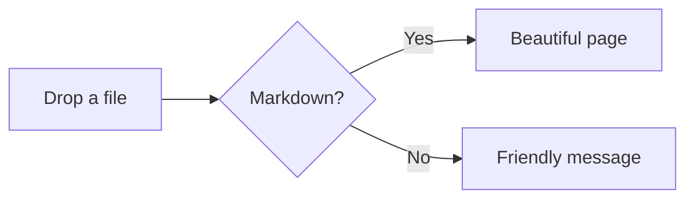

# Welcome to Super Markdown

This page shows everything Super Markdown can display. Open the **reading options** (the sliders icon, top right) and try a few themes while you read.

> [!TIP]
> Drag any `.md` file onto this window to read it. Drop a **whole folder** to see its images and click links between its files.

## Reading comfort

Everything here can be changed in the reading options:

| Option | What it does | Shortcut |
|---|---|---|
| Theme | Light, Paper, Mint, Dark, Night, High contrast, or Auto (follows your computer) | `T` |
| Font | Readable (Atkinson Hyperlegible), Sans, Serif, Mono | none |
| Text size | 13 px to 30 px | `+` / `-` |
| Line and letter spacing | Room between lines and letters | none |
| Reading ruler | A bright band that follows your mouse; the rest is dimmed | `R` |
| Section cards | Each section sits on its own card | none |

> [!NOTE]
> The **Dyslexia-friendly** preset sets a larger readable font, wider spacing, a narrow page, cards, a ruler and the warm Paper theme, all in one click.

## Text formatting

Plain paragraphs read at a comfortable width. You also get **bold**, *italic*, ***both***, ~~strikethrough~~, ==highlighted text==, `inline code`, <kbd>Ctrl</kbd> + <kbd>C</kbd> keys, H<sub>2</sub>O and x<sup>2</sup>.

Links work too: [an external site](https://example.com) opens in a new tab, and [a jump to the code section](#code) scrolls this page.

### Lists

1. Numbered lists
2. Keep their numbers
   - and can nest
   - as deep as you like
3. Back to the top level

- [x] Task lists show ticked items
- [x] in a softer color
- [ ] and open items stand out

### Quotes

> A good quote sits apart from the text around it.
>
> It can span several paragraphs.

## Callouts

> [!NOTE]
> Useful information the reader should notice.

> [!TIP] Custom titles work too
> A helpful hint. Write a title after the marker.

> [!IMPORTANT]
> Key information people need to know.

> [!WARNING]
> Something that needs attention right away.

> [!CAUTION]
> Something risky. Think before doing it.

> [!NOTE]- Click to open a folded callout
> Add a `-` after the marker to fold it, or `+` to fold it but start open.

## Code

```python
def greet(name: str) -> str:
    """Say hello in a friendly way."""
    return f"Hello, {name}!"

print(greet("world"))
```

```javascript
const items = ['apples', 'pears', 'plums'];
items.forEach((item, i) => console.log(`${i + 1}. ${item}`));
```

```diff
- old line that was removed
+ new line that was added
```

Every code block has a **Copy** button. Turn on *Wrap long code lines* if lines run off the side.

## Tables

Click a column header to sort.

| Planet | Moons | Distance from Sun (AU) |
|:--|--:|--:|
| Mercury | 0 | 0.39 |
| Venus | 0 | 0.72 |
| Earth | 1 | 1.00 |
| Mars | 2 | 1.52 |
| Jupiter | 95 | 5.20 |
| Saturn | 146 | 9.54 |

## Math

Inline math like $E = mc^2$ sits in the sentence. Prices such as $5 and $10 stay as plain text.

$$
\int_0^1 x^2 \, dx = \frac{1}{3}
$$

## Diagrams



## Footnotes and more

Footnotes keep side notes out of the way.[^1] You can have several.[^more]

<details>
<summary>Click to show hidden details</summary>

Raw HTML such as `<details>` works. Anything unsafe, such as scripts, is removed before the page is shown.

</details>

---

That's it. Drop your own file to get started.

[^1]: This is the first footnote. Click the arrow to jump back.
[^more]: Footnotes collect at the bottom of the page.
